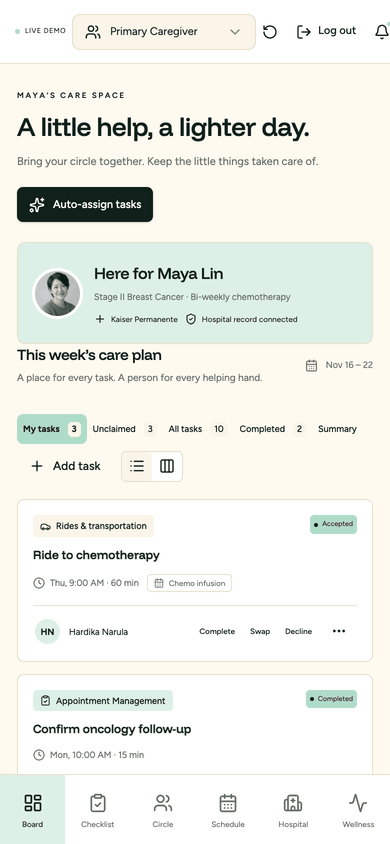
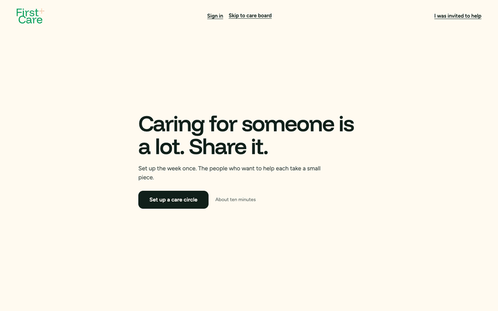
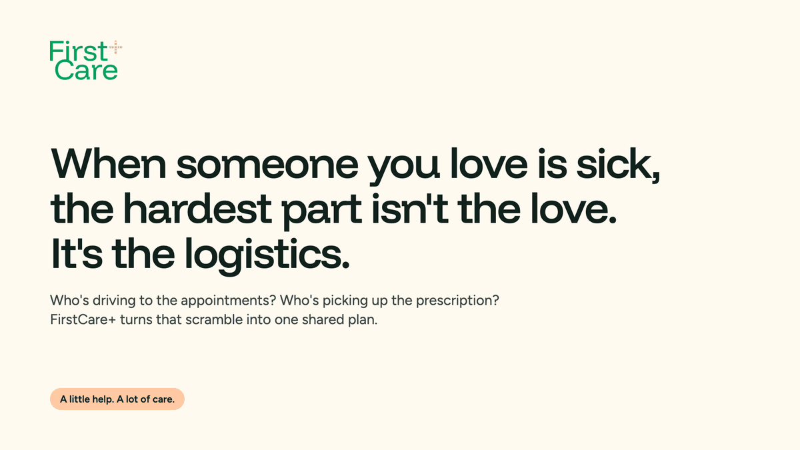

# FirstCare+ — Product Requirements (README)

**A little help. A lot of care.**
FirstCare+ is a caregiver-coordination app. It helps a patient or primary caregiver turn "who's doing what this week?" into a shared plan that the whole care circle can see and pick up.

## The app, screen by screen

FirstCare+ is a phone-first web app. Six screens, three seconds each:

1. **Care board.** This week's tasks: mine, unclaimed, all, completed, and a summary.
2. **Care checklist.** Tasks generated from the hospital record, reviewed before they are shared.
3. **Care circle.** Each caregiver's visibility, weekly task cap and availability.
4. **Appointments.** Upcoming visits from Kaiser, and rescheduling that moves the linked tasks.
5. **Hospital connection.** Patient consent and the simulated Kaiser Permanente connection.
6. **Wellness and vitals.** Simulated Apple Watch and Oura readings that can raise a check-in task.

## Onboarding: the whole experience in ten screens

The guided setup at [/setup](https://firstcareplus.lovable.app/setup) walks through everything the app does. Each screen holds for three seconds.

1. **Welcome.** Set up a care circle.
2. **Who are you caring for?** Name, relationship, and what she is going through.
3. **Bring in visits from Kaiser.** What comes in, and what helpers never see.
4. **Kaiser consent.** The patient allows access. This screen is simulated for the demo, with a synthetic patient.
5. **Here is what came in.** Three visits and two medicines.
6. **The checklist.** Everyday tasks by treatment phase: chemotherapy, surgery, recovery and follow-up.
7. **Who has offered to help?** Helpers see tasks only.
8. **One group text.** Asks arrive by text. Reply yes, swap or can't.
9. **Calendar.** Optional, coming soon.
10. **The week has a plan.**

## User flow at a glance

The flow in seven steps, with screens from the live app. Each step holds for about four seconds.

1. **The problem.** When someone you love is sick, the hard part is the logistics.
2. **Onboarding: the checklist.** The primary caregiver enters the diagnosis and treatment plan, and a care checklist is built by phase. Kaiser appointments flow in (simulated for the demo).
3. **Onboarding: the circle.** Family and friends set their availability and a weekly task cap. Auto-assign gives every task to someone who can do it.
4. **Task view.** My tasks, Unclaimed, and a Summary of the week.
5. **Rescheduling.** Chemo moves, and the linked ride, prescription pickup and meal move with it.
6. **Messaging.** Each caregiver gets one clear text. A reply of "can't make it" passes the task to the next person. No medical details in the text.
7. **Closing.** No one should do it alone.

Try it: https://firstcareplus.lovable.app · Guided setup: https://firstcareplus.lovable.app/setup · Slides: [FirstCare-demo-deck.pdf](public/FirstCare-demo-deck.pdf)

_These two GIFs and sections were added after the submission deadline._

## What it does

1. The patient or primary caregiver creates an account and builds a care circle.
2. A weekly care plan is created: appointments plus the tasks around them (rides, meals, medicine pickup, at-home care, follow-ups).
3. Tasks are assigned automatically based on each caregiver's availability and weekly task cap. Caregivers can also sign up for open tasks, swap, or decline with a private reason.
4. When plans change (for example, a rescheduled chemo infusion), linked tasks move with it and the circle is notified.
5. Every caregiver is notified by email or phone number.

## App structure (tabs)

| # | Tab | Purpose |
|---|-----|---------|
| 1 | My tasks (landing) | What you've taken on |
| 2 | Unclaimed | Open tasks that still need a helping hand, with a count badge |
| 3 | All tasks | Everyone's tasks, with sign-up and swap options |
| 4 | Completed | What's already taken care of |
| 5 | Summary | Week calendar with all tasks and assignees, plus the four stat tiles (Tasks this week, Taken care of, Need a helping hand, Your care circle) |

## PRD contents

- Project description (presentation-ready)
- Overview, goals, non-goals and success metrics
- Personas
- Core journey
- Functional requirements (P0 = hackathon build)
- Assignment logic
- Notifications
- Integrations (hospital record connection starting with Kaiser; AI via Lovable's built-in AI; Linq messaging is optional)
- Privacy
- Hackathon build plan (4 hours)
- Version 2: wearables (Apple Watch, Garmin, Oura and similar) feeding data back for caregiver review
- Risks and open questions (all answered)

## Hackathon constraints

- 4 hours, team of 3
- 100 Lovable credits; the demo must be shown on Lovable (our sponsor)
- Synthetic demo data only; no real notifications are sent in the prototype

## Tech

- Lovable app (React, Vite, Tailwind, Supabase), synced two-way with GitHub
- Messaging via Linq (iMessage/RCS/SMS) is optional

## Team workflow

- GitHub is the shared source of truth. Pull before you start, commit small, push often.
- Use Lovable only for changes that need its AI, since credits are charged only when Lovable's AI edits code.
- One person edits a given screen at a time to avoid merge conflicts.
