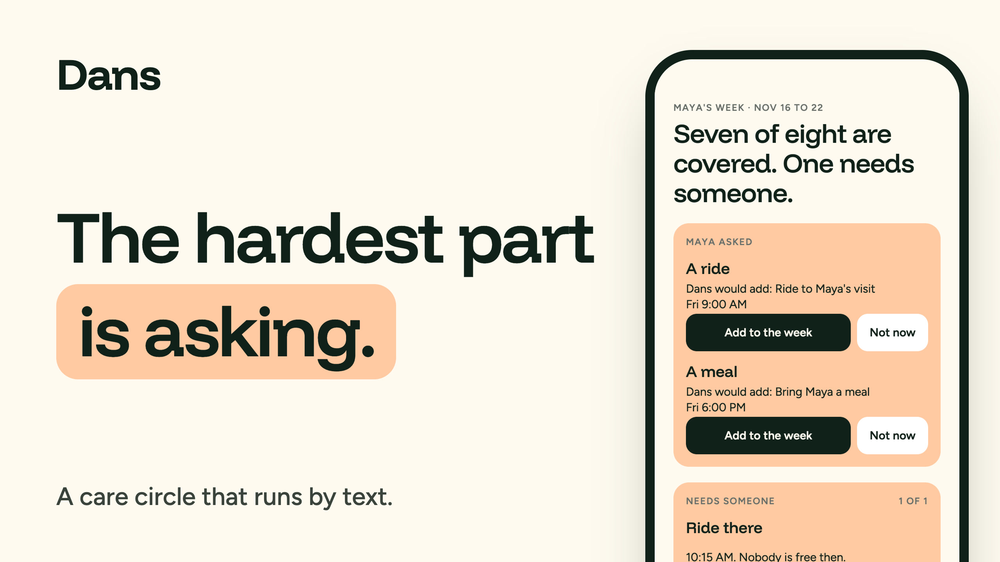
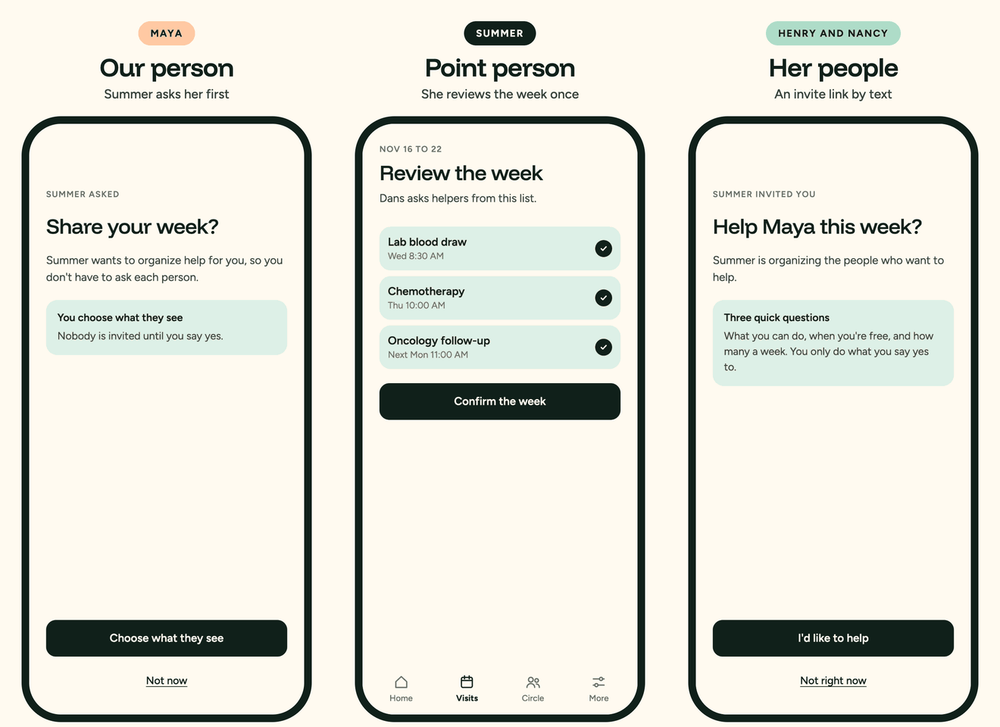

# Dans

When someone you love needs help, the hardest part is asking. Dans does the asking.

Dans is a care circle that runs by text. One person keeps the week moving, the people who want to help answer with a thumbs up or down, and the person at the center never has to ask each of them.

[](https://youtu.be/bMaPqeCkb9E)

- **Watch the story (2:44):** https://youtu.be/bMaPqeCkb9E
- **Try the demo on your phone:** https://dans-support.vercel.app (sample data, no login yet)

## Who is in the circle



| Our person | Point person | Her people |
|---|---|---|
| **Maya.** The one the circle is for. | **Summer.** Owns the week and handles what is left. | **Henry and Nancy.** Family and friends who help. |
| She is asked first. She decides what her people can see, sees who is coming, and tells Summer what would help. | She reviews the week once. Dans matches each task to someone who is free, and she only sees what nobody can take. | They get a link, say what they can do and when they are free, and set their own limit. After that it is one text at a time. No app, no login. |

## How a week works

1. Summer asks Maya first. Maya says yes and chooses what her people can see.
2. Each person gets their own link. They say what they can do, when they are free, and how many tasks a week.
3. Summer reviews the week once and confirms it. Dans matches every task to someone who is free.
4. Dans asks by text, one task at a time: "Henry, can you pick up Maya's prescriptions Thu, Nov 19 at 12:30 PM?" with "👍 reply YES / 👎 reply PASS".
5. When someone passes, Dans asks the next free person. Summer hears nothing unless nobody is free. Then Dans asks her, "Can you take it?"
6. On the morning of a task, Dans checks that the person can still do it.

## What is live and what is sample

- **Live:** texting, replies, passing a task to the next person, Maya's page, the sign-up for her people.
- **Built, still being tested:** the morning check.
- **Sample:** the week of visits (labelled "Sample visit"), the people in the circle, and the times they are free.
- **Next:** her own calendar, sign-in, and the first families.

## How it is built

TanStack Start, Vite, Tailwind v4 and Vitest. Supabase for the database. Linq for texts. Hosted on Vercel.

```bash
npm install
cp .env.example .env     # fill in the values, never commit .env
npm run dev
npm test
```

## Where it came from

Dans is the second version of FirstCare+, first built at the She Builds hackathon. The product vision is the same. The name and the experience changed: fewer screens, one job per screen, and the asking moved into a text.

Made by Summer Chang and Hardika Narula.

Made-up data only. Not medical advice.
